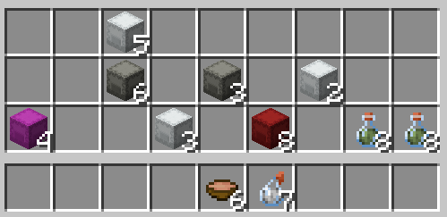

Changes stack sizes for items that normally do not stack well, including potions,
stews, boats, minecarts, saddles, shulker boxes, and music discs.



Stack sizes are configured in `plugins/Stackable/config.yml`:

```yml
items:
  potion: 8
  saddle: 16
  "*_boat": 4
  "music_disc_*": 16
```

Wildcard rules work with material names, so one entry can cover every boat,
minecart, colored shulker box, or music disc.

Different stack sizes can also be assigned through permission groups. For
example, `stackable.group.vip` can give VIP players larger potion or saddle
stacks. The highest matching stack size wins.

Run `/stackablereload` after changing the config.

Permissions: `stackable.use`, `stackable.reload`, `stackable.admin`, and
`stackable.group.<name>`.
